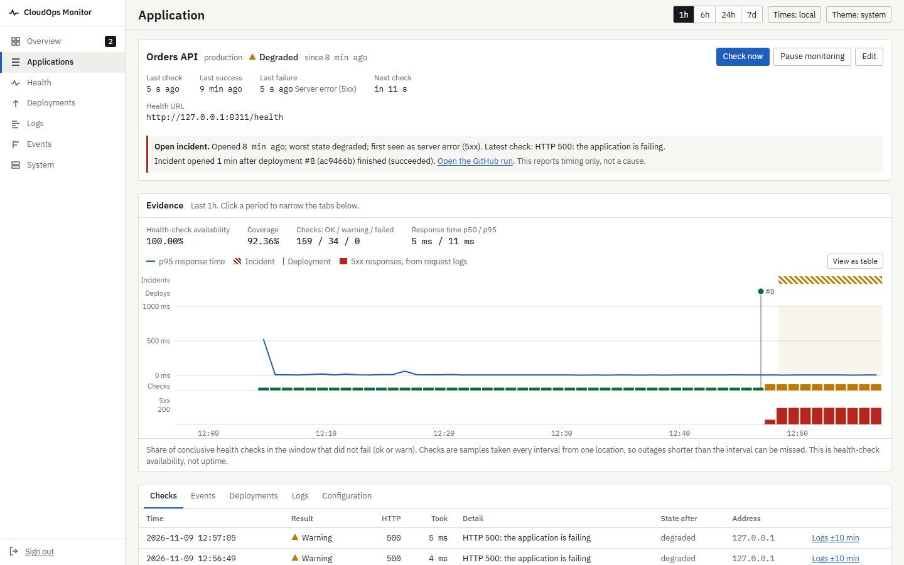
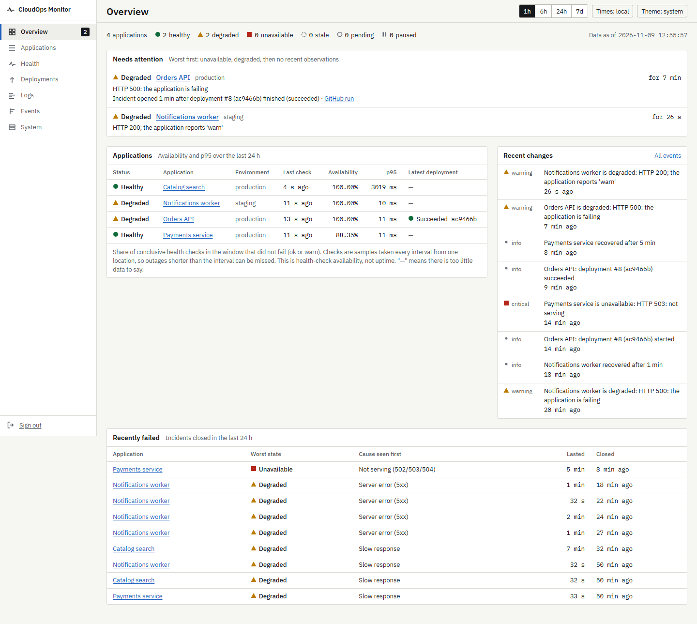
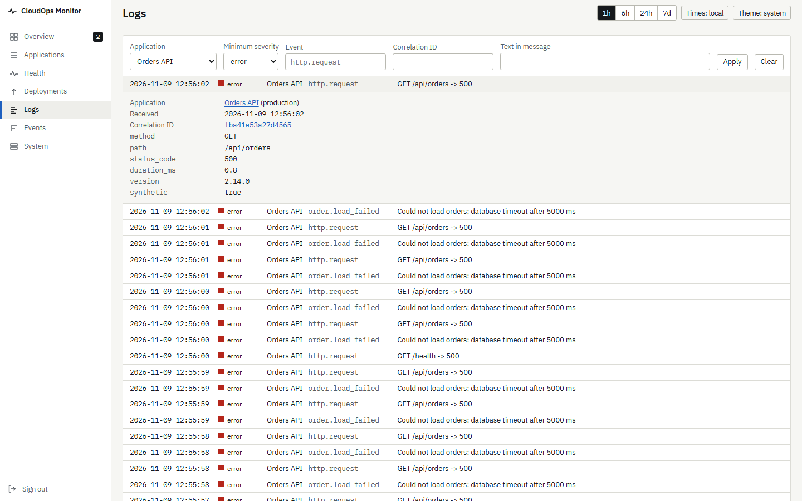
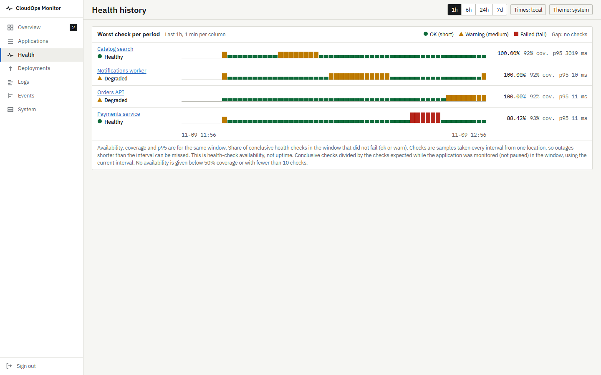
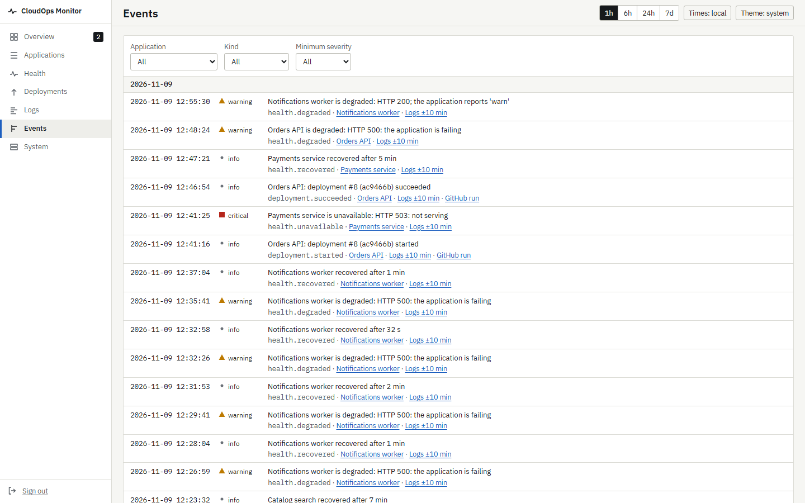
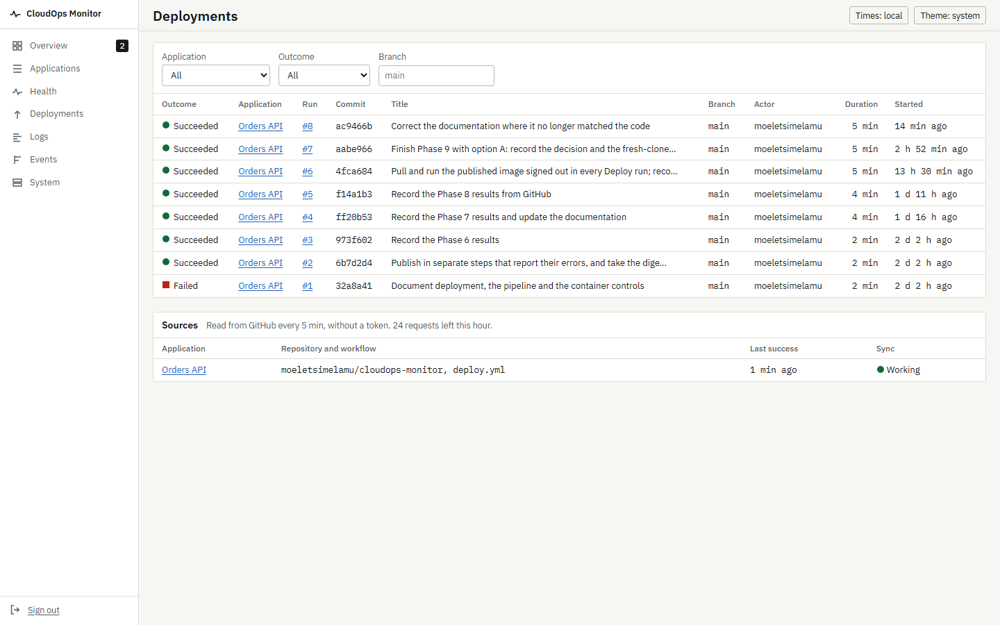
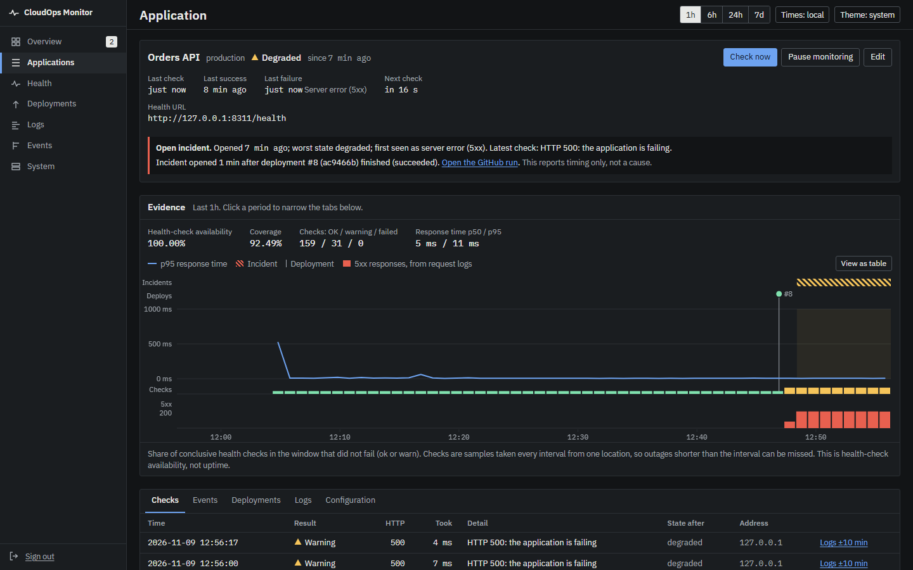
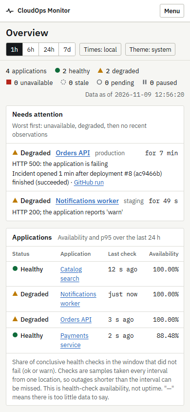
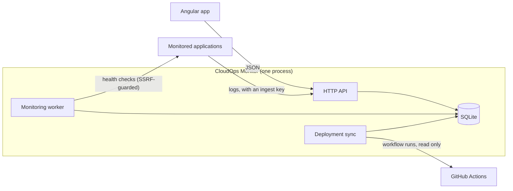

# CloudOps Monitor

Application health, deployments, logs and operational events in one place, for a developer or a
small team. When something breaks it answers four questions on one screen: **what is broken, since
when, what changed, and what the evidence says**.



*Every value in these screenshots is real: four instances of the bundled sandbox service, given
fictional names, checked by CloudOps Monitor for about an hour, with real HTTP responses and real
request logs. The deployment is a real run of this repository's Deploy workflow. What was staged is
which response each sandbox gave, and when ([details](#about-the-screenshots)).*

It is the third project in a portfolio, after
[OpsHub](https://github.com/moeletsimelamu/opshub) (an IT service desk, ASP.NET Core and Angular)
and [DocuMind](https://github.com/moeletsimelamu/documind) (a document question-answering
assistant, FastAPI and Angular). This one is about operations: monitoring, diagnosis and delivery.

**Status:** complete, in ten phases ([docs/PLAN.md](docs/PLAN.md)). It runs on your own machine
or as the published container image; it is not hosted anywhere.

## The problem it solves

A developer ships a new version. Minutes later the application starts returning errors. Finding out
why usually means jumping between the CI dashboard, the server's logs, a status page and guesswork.
CloudOps Monitor puts the signals side by side on one time axis:

- the health check went from **healthy to degraded at 14:07**,
- the **deploy of `a1b2c3d` finished at 14:03**,
- the application's request logs show **5xx responses from 14:04**.

It reports that the incident opened *after* the deployment, never that the deployment *caused* it:
timing is evidence, not a diagnosis.

## What it does

- **Health checks** on a schedule, with timeouts and a documented classification of every kind of
  response and network failure into `ok`, `warn`, `fail` or `inconclusive`.
- **A health state machine** (healthy, degraded, unavailable) with hysteresis, so one failed check
  does not raise an alarm and one success does not declare recovery, and **staleness**, so an old
  success never looks current.
- **Incidents and events** recorded on state changes only: a failure that lasts six hours is one
  event, not 360.
- **Availability with its coverage**: the share of checks that passed, shown next to how much of
  the window was actually observed, and "insufficient data" rather than a number when too little
  was.
- **Deployment history** read from real GitHub Actions workflow runs, linked to incidents by
  timing.
- **Log ingestion and a log explorer**: applications push structured logs with a per-application
  key; secrets are masked before storage; filters by severity, event, correlation ID, text and time.
- **Request error counts** from the applications' own request logs, on the same time axis.
- **The troubleshooting page** per application, which combines all of the above.
- **System status**: liveness, readiness, the worker's heartbeat, and the configuration without
  secrets.
- **A sandbox service** you can switch between healthy, degraded, erroring, slow, unavailable and
  flaky. It is the demo target and the target of the end-to-end tests: there is no simulated data
  anywhere.

## Screenshots

**Overview: what needs attention.** Open incidents and degraded applications first, then every
application with its availability, response time and latest deployment, and the recent changes.



**Logs.** Error entries shipped by the Orders API sandbox, one expanded to show its attributes and
correlation ID.



| Health history | Events |
|---|---|
|  |  |

| Deployments | Dark theme |
|---|---|
|  |  |



**On a phone** the navigation becomes a menu, tables drop their least important columns and the
timeline shrinks to fit, so the newest data stays on screen.

The main journey works with a keyboard alone, and automated accessibility checks (axe, at every
severity) find nothing on any of them at phone or desktop width, in either theme.

<br clear="right">

## Architecture

A modular monolith: one FastAPI process serves the API and the built Angular app and runs the
monitoring worker as an asyncio task. SQLite (WAL) stores everything. Applications push their logs
to an ingest endpoint; deployment records are pulled from the GitHub REST API, so nothing has to
be exposed to the internet. [docs/ARCHITECTURE.md](docs/ARCHITECTURE.md) has the details.



| Area | Technology |
|---|---|
| API and worker | Python 3.12+ (developed on 3.14), FastAPI, Pydantic, SQLAlchemy 2.1, Alembic, httpx2/httpcore2 |
| Database | SQLite in WAL mode |
| Frontend | Angular 21 (standalone components, signals, no zone.js), TypeScript, hand-written charts, IBM Plex fonts |
| Tests | pytest, Vitest, Playwright with axe |
| Delivery | Docker, Docker Compose, GitHub Actions, GitHub Container Registry |

## Key engineering decisions

- **SSRF protection with pinned connections.** A health-check URL is an invitation to make the
  server fetch something. Targets must be on an operator-set allowlist (or, optionally, public);
  the probe resolves the name, checks every address (including IPv6 forms that hide an IPv4 address,
  such as NAT64), and connects to the address it checked, so a DNS answer cannot change in between.
  Cloud metadata addresses are never reachable. Redirects are not followed.
- **Four signals, not two.** `inconclusive` (the monitor could not observe) is kept apart from
  `fail` (the application is broken), so a problem on the monitor's side never shows as an outage.
- **Honest numbers.** "Health-check availability", never "uptime"; coverage beside every
  percentage; gaps in a chart stay gaps instead of being interpolated.
- **No simulated data.** The sandbox gives real responses from a real process; only which response
  it gives is chosen. The demo, the smoke test and the browser tests all use it.
- **Tested as a running system.** System tests start the real server and kill it mid-check, hold
  its database lock from another process, give it a damaged database and load it with 1.15 million
  stored checks. That found six defects unit tests could not, including clean-up that stopped all
  health checks for 18 seconds.
- **Security reviewed and fixed.** A review found and fixed seven problems, each first reproduced
  on the old code ([docs/REVIEW.md](docs/REVIEW.md)): for example, sessions now end when the
  operator token is rotated, and request bodies are limited before authentication.
- **Delivery checks what users get.** Every release pulls the image it just published, without
  signing in, and runs it with the documented command before anything else happens.

The decision log in [docs/PLAN.md](docs/PLAN.md) records 63 decisions with their reasons.

## Running it

### With Docker

With Docker installed, CloudOps Monitor and the sandbox start together. Put two random values in a
file named `.env` next to `compose.yaml`:

```
CLOUDOPS_OPERATOR_TOKEN=<at least 32 random characters>
SANDBOX_CONTROL_TOKEN=<another random value>
```

```bash
docker compose up --build -d
```

Then open http://localhost:8300, sign in with the operator token and register
`http://sandbox:8310/health`. [docs/DEPLOYMENT.md](docs/DEPLOYMENT.md) covers the image on its own,
backups, upgrades and the pipeline.

### Development setup (backend)

Requires Python 3.12 or newer. Commands are shown for Windows (PowerShell). On Linux or macOS, use
`.venv/bin/` instead of `.venv\Scripts\`.

```powershell
cd backend
python -m venv .venv
.venv\Scripts\python -m pip install -c constraints.txt -e ".[dev]"
```

Configure, then start the API on http://127.0.0.1:8300 (migrations run automatically):

```powershell
copy ..\.env.example .env
.venv\Scripts\cloudops generate-token
```

Put the generated token in `CLOUDOPS_OPERATOR_TOKEN` in `backend/.env`, then:

```powershell
.venv\Scripts\cloudops serve --port 8300
```

A setting it cannot use stops it at once with one log line naming the variable (exit status 2).

Checks used during development and in CI. The full suite includes system tests that start the real
server as a separate process (restarts, a locked database, retention on 1.15 million checks) and
takes about five minutes; `-m "not system"` leaves them out:

```powershell
.venv\Scripts\python -m pytest
```

```powershell
.venv\Scripts\ruff check .
```

```powershell
.venv\Scripts\mypy
```

Health endpoints: `GET /api/health/live` (process up) and `GET /api/health/ready` (database and
schema usable). API documentation is at `/api/docs` while `CLOUDOPS_API_DOCS=true`.

### Development setup (frontend)

Requires Node.js 22. With the API running on port 8300, this serves the interface on
http://localhost:4300 and passes `/api` requests through to the API:

```powershell
cd frontend
npm ci
npm start
```

Sign in with the operator token. Checks used during development:

```powershell
npm test
```

```powershell
npm run format:check
```

```powershell
npm run build
```

Browser end-to-end tests (Playwright) run the production build against the real server and the
sandbox, each started for the run with an empty database. They need the backend and the sandbox
installed in `backend/.venv` (or the Python named in `E2E_PYTHON`) and a build:

```powershell
npx playwright install chromium
```

```powershell
npm run build; npm run e2e
```

### Trying it with the sandbox

The sandbox (`sandbox/`) is a small service whose health you switch on purpose. CloudOps Monitor
then observes real HTTP responses from a real process. Install it into the backend's environment
and run it on http://127.0.0.1:8310:

```powershell
.venv\Scripts\python -m pip install -e ..\sandbox
.venv\Scripts\python -m cloudops_sandbox
```

With `CLOUDOPS_ALLOWED_TARGETS=localhost:8310` in `backend/.env`, register it under **Applications**
in the interface with the health URL `http://localhost:8310/health`, or through the API, and then
break it (any HTTP client works; these use PowerShell):

```powershell
$h = @{ Authorization = "Bearer <your operator token>" }
Invoke-RestMethod -Method Post http://localhost:8300/api/applications -Headers $h -ContentType application/json -Body '{"slug":"sandbox-orders","name":"Sandbox orders","environment":"demo","check_url":"http://localhost:8310/health","interval_seconds":15}'
Invoke-RestMethod -Method Put http://localhost:8310/control/mode -ContentType application/json -Body '{"mode":"errors"}'
```

Within two checks the application turns **degraded**, an incident opens and an event is recorded.
Switch back with `{"mode":"healthy"}` to see it recover. The sandbox's modes are `healthy`,
`degraded`, `errors`, `slow`, `unavailable` and `flaky`.

To see logs and failing requests as well, create an ingest key for the application and restart the
sandbox with it. `SANDBOX_TRAFFIC_RPS` makes it call its own API, so there are requests to observe;
those requests are real but generated, and are logged with `synthetic=true`:

```powershell
$key = (Invoke-RestMethod -Method Post http://localhost:8300/api/applications/sandbox-orders/ingest-key -Headers $h).ingest_key
$env:SANDBOX_CLOUDOPS_URL = "http://localhost:8300"
$env:SANDBOX_INGEST_KEY = $key
$env:SANDBOX_TRAFFIC_RPS = "2"
.venv\Scripts\python -m cloudops_sandbox
```

Then open the application in the interface: the evidence timeline shows the incident, the failing
checks and the 5xx responses on one time axis, with the logs one tab away.

To record deployments, set `github_repo` and `deploy_workflow` on an application. CloudOps reads that
workflow's runs from GitHub every 5 minutes. Public repositories need no token, but share GitHub's
limit of 60 requests an hour per IP address, so a network with other GitHub API traffic can use it
up. A fine-grained token with *Actions: read* (`CLOUDOPS_GITHUB_TOKEN`) avoids that. CloudOps only
ever reads from GitHub: it cannot start a deployment.

## Testing

| Suite | What it covers | Count |
|---|---|---|
| Backend unit and API tests | Classification, the state machine, availability, redaction, the SSRF policy, the probe against real local servers, every API route, authentication, limits | 545 |
| Backend system tests | The real server as a separate process: bad settings at start-up, stop and restart, killed during a check, a locked or damaged database, timeouts, time zones, retention on 1.15 million checks, proxies, token rotation | 21 |
| Sandbox | The test target and its log shipper | 17 |
| Frontend unit and component tests | Screens, states, the timeline, formatting | 78 |
| Browser end-to-end (Playwright) | The whole journey through the interface, every screen at two sizes in both themes with axe, keyboard use, signing out everywhere, losing the API, a lost session, a UTC+14 browser | 20 |

Counts are from the final runs recorded in [the Phase 10 report](docs/PHASE_REPORTS/phase-10.md).
One system test needs POSIX file permissions, so it is skipped on Windows and runs in CI.

### Continuous integration and delivery

Every push runs ruff, mypy, all the tests above on Python 3.12 and 3.14, Prettier, the production
build, the browser tests, a dependency audit (`pip-audit`, `npm audit`) and a container job that
builds both images, checks they run as non-root users on a read-only file system with no Linux
capabilities, and runs the smoke test. On `main`, the Deploy workflow then publishes the image to
GitHub Container Registry, **pulls it back without signing in and runs it as documented**, and
reports "Not rolled out" because no server is configured. It never claims a deployment that did not
happen.

## Security

Single-operator token authentication with HttpOnly, SameSite=Strict session cookies bound to the
token; a strict SSRF policy with pinned connections; per-application ingest keys stored as hashes;
redaction of secrets in its own logs and in ingested ones; request size and rate limits; security
headers and a content security policy; containers that run unprivileged and read-only.
[docs/SECURITY.md](docs/SECURITY.md) has the threat model and every control, and
[docs/REVIEW.md](docs/REVIEW.md) the review that found and fixed seven problems.

Single-operator token authentication is not a multi-user security model: there are no accounts,
roles or audit of who did what.

## Deployment

The container image is public: `ghcr.io/moeletsimelamu/cloudops-monitor` (linux/amd64).
[docs/DEPLOYMENT.md](docs/DEPLOYMENT.md) covers running it, backups, upgrades and the pipeline.

It is not hosted. Running it on one small server behind an HTTPS proxy is designed and the deploy
workflow supports it, but prices were checked and no server was set up, because there was no
budget for one ([docs/PLAN.md](docs/PLAN.md) §6).

## Known limitations

- **One operator token**, no user accounts, roles or MFA.
- **One process and one SQLite file.** That is a deliberate fit for a handful of applications, not a
  design for many instances or high write rates. With about a million stored checks, the overview
  takes a few hundred milliseconds to load.
- **Checks come from one place** and are samples: an outage shorter than the interval can go unseen,
  and a network problem near the monitor can look like an outage.
- **No notifications** (email, chat, webhooks): you see problems when you look.
- **Log redaction is pattern-based**, so it cannot catch every secret or piece of personal data.
- **Not tested with a screen reader**, and the browser tests run in Chromium only.
- **The image is built for amd64 only.**

[docs/SECURITY.md §10](docs/SECURITY.md#10-known-limitations) lists the security limitations in
full.

## Future improvements

- Notifications on state changes (a webhook or email), which the event model was designed for.
- Precomputed summaries, so large histories load faster.
- User accounts through an identity provider instead of one shared token.
- Multi-architecture images, and the one-server deployment once there is a place to run it.
- A pass with a screen reader.

## Documentation

| Document | Contents |
|---|---|
| [docs/ARCHITECTURE.md](docs/ARCHITECTURE.md) | Components, health-check classification and state machine, events, logs, deployments, data model |
| [docs/DESIGN.md](docs/DESIGN.md) | Interface principles, visual identity, screens, accessibility, responsive behaviour |
| [docs/SECURITY.md](docs/SECURITY.md) | Threat model, SSRF controls, authentication, secrets, logging hygiene, known limitations |
| [docs/REVIEW.md](docs/REVIEW.md) | The security and quality review: findings, how each was reproduced, and the fixes |
| [docs/DEPLOYMENT.md](docs/DEPLOYMENT.md) | The image and Compose setup, operating it, the CI/CD pipeline, the server option |
| [docs/PLAN.md](docs/PLAN.md) | Scope, structure, versions, testing plan, hosting costs, and the decision log |
| [docs/PHASE_REPORTS/](docs/PHASE_REPORTS/) | What each of the ten phases built and verified, with real results |

## About the screenshots

They were taken on 2026-11-09 from CloudOps Monitor's production build, served by `cloudops serve`
on Windows, watching four sandbox processes for about an hour. The applications' names are
fictional; everything else on screen was observed:

| Time (UTC+2) | What happened |
|---|---|
| 12:05 | CloudOps Monitor started with an empty database; the four sandboxes registered, checked every 15 s. In the first minute, three of them took over a second to answer while all five processes started at once on one laptop: those short "Slow response" incidents were not staged. |
| 12:15 to 12:23 | Catalog search switched to answering slowly (3 s). |
| 12:25 to 12:37 | Notifications worker switched to failing about half its responses. |
| 12:41 to 12:47 | Payments service switched to answering 503. |
| 12:41 to 12:47 | Deploy run #8 of this repository ran on GitHub (publishing the documentation fixes of this phase) and finished at 12:46:54. Orders API is linked to that workflow. |
| 12:47:53 | Orders API switched to failing with 500s. CloudOps marked it degraded 31 s later and reported the incident as opening 1 min after deployment #8 finished. |
| 12:55 | Notifications worker switched to reporting itself degraded (`"status": "warn"`). |
| 12:56 to 12:57 | Screenshots taken. |

Each sandbox also called its own API, between once every two seconds and twice a second, and shipped a log entry per
request, so the logs and 5xx counts are real requests and real responses.
