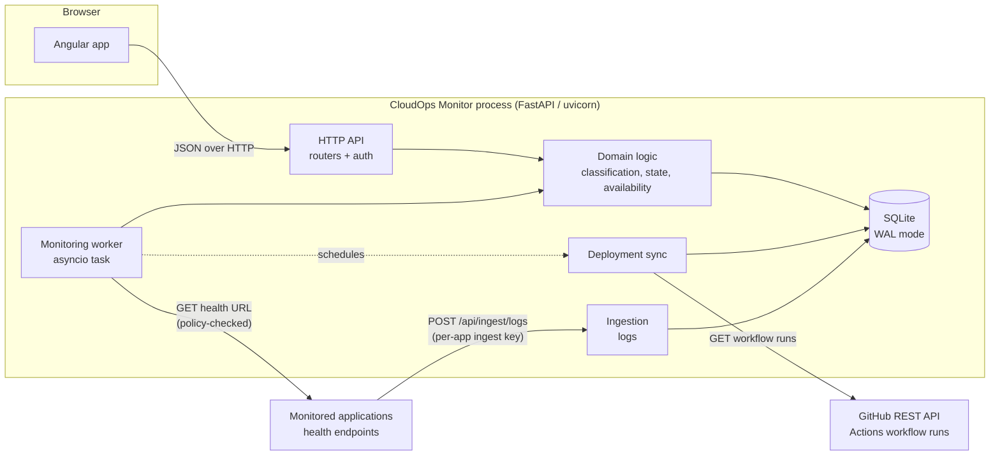
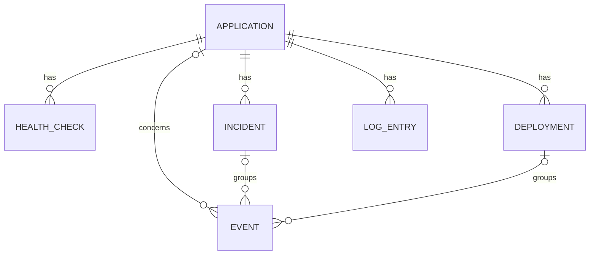

# CloudOps Monitor — Architecture

> **Status:** Phases 2 to 7 complete: the backend described here and the Angular frontend are
> implemented and tested, including as a running system and through a browser, and run as one
> container image in which the API process also serves the built frontend (`spa.py`). Packaging and the pipeline are in [DEPLOYMENT.md](DEPLOYMENT.md). Differences from the design are
> recorded in the decision log in [PLAN.md](PLAN.md).

## 1. Shape of the system

CloudOps Monitor is a **modular monolith**: one Python process serves the API, runs the monitoring
worker, and (in the container) serves the built Angular app. One SQLite database holds all state.



Why a monolith rather than separate API / worker / ingest services:

- The expected load is a handful of applications checked once a minute. One process is enough by a
  wide margin.
- SQLite allows one writer at a time. A single process makes that easy to coordinate.
- A single process makes the system easier to run, explain and test. The modules below still have
  clear boundaries, so the worker could become its own process later
  (`python -m cloudops.worker`) without rewriting it.

## 2. Components and responsibilities

| Module (`backend/src/cloudops/…`) | Responsibility | Talks to |
|---|---|---|
| `config.py` | Typed settings from `CLOUDOPS_*` environment variables (pydantic-settings). Validates at start-up and collects non-fatal configuration warnings for the System view. Secrets are `SecretStr` and never serialised. | — |
| `logging_setup.py` | JSON-lines structured logging to stdout, a request-ID middleware, and a redaction filter. | — |
| `api/` | FastAPI routers, request/response schemas, the error envelope, auth dependencies and pagination helpers. Contains no business rules. | `domain`, `db` |
| `domain/` | Pure functions: check classification, the health state machine, incident open/close, availability and latency statistics, redaction rules and deployment-status mapping. No I/O, so it is unit-tested exhaustively. | — |
| `monitoring/` | Target policy (SSRF guard), the HTTP probe, the recorder (check → state → incident → events in one transaction), the check runner shared by the scheduler and "check now", the worker loop with heartbeat, and retention clean-up. | `domain`, `db`, network |
| `events.py` | Writing operational events in the caller's transaction. | `db` |
| `deployments/` | GitHub Actions client (REST, ETag-aware), mapping runs to `DeploymentRecord`s, and the sync job. | `domain`, `db`, GitHub |
| `ingest/` | Validation, size limits and redaction for pushed log batches. | `domain`, `db` |
| `db/` | SQLAlchemy 2.x models, engine/session setup (WAL, foreign keys, busy timeout), repositories (query functions), and Alembic migrations. | SQLite |
| `sandbox/` (separate small package) | A controllable **test target**: a tiny FastAPI service whose health endpoint can be switched between healthy, erroring, slow, unavailable and flaky. It ships its request logs to CloudOps. It is used for local demos, the smoke test and the end-to-end tests. | CloudOps ingest |

The frontend is a separate Angular workspace (`frontend/`) that talks only to the HTTP API. It uses
standalone components, signals and no zone.js:

| Folder | Holds |
|---|---|
| `src/app/core/` | The API client, session handling, polling (`poll`, `pagedPoll`), preferences (theme, time zone, time range in the URL), formatting. |
| `src/app/shared/` | Status badges, loading/empty/error states, the log, event and deployment lists, and the evidence timeline with its scales. |
| `src/app/features/` | The screens, each loaded on demand. |

## 3. Health checks

### 3.1 Scheduling

- Each application stores `interval_seconds` (15–3600, default 60) and `next_check_at`.
- The worker loop wakes every second. It selects applications that are due, enabled and not
  already in flight, and launches their probes concurrently. A semaphore caps concurrency
  (`CLOUDOPS_MONITOR_MAX_CONCURRENCY`, default 10).
- Every probe runs under a hard deadline: `asyncio.timeout(timeout_seconds + 1)`, around
  httpcore2 connect, read and write timeouts. A slow target can delay only its own next check,
  never the loop or the other targets (tested: a 1 s target does not hold up a fast one).
- At most one check per application runs at a time. The scheduler and "check now" share the same
  in-flight set, and "check now" gets 409 while a scheduled check runs.
- Database work runs in worker threads. The worker shares the API's event loop and must never
  block it.
- After a probe, `next_check_at = started_at + interval`, plus jitter of up to 10% so checks spread
  out. If the worker falls behind, overdue checks run once. Missed slots are not replayed.
- **Run check now** (API, authenticated) calls the same probe directly and stores the result like
  any other check. It is rate-limited to one call per application every 5 seconds.

### 3.2 The probe

1. **Policy check before connecting** (see §7 and [SECURITY.md](SECURITY.md)). The URL scheme,
   host and port must match the target policy.
2. **Pinned connection.** The probe uses httpcore2's connection pool directly, because unlike
   httpx2's transport it accepts a custom network backend. The hostname is resolved inside that
   backend. Every resolved address is checked against the blocked ranges, and the connection is
   made to an address that was checked. This avoids a time-of-check/time-of-use gap (DNS
   rebinding). TLS still verifies the certificate against the original hostname (SNI). Proxy
   environment variables are never read, and every check opens a fresh connection.
3. **Several addresses ("Happy Eyeballs", RFC 8305).** When a name resolves to several addresses,
   attempts start 250 ms apart, or as soon as the previous one fails, and the first to connect
   wins. *Found in the Phase 3 live run:* trying addresses strictly in turn made every
   `localhost` check wait about 2 s for `::1` to be refused on Windows. A healthy sandbox was
   reported as slow and degraded. The measured time still includes the stagger (about 250 ms in
   that case), which a real client would also experience.
4. A `GET` with `Accept: application/json, */*`, a fixed `User-Agent: CloudOpsMonitor/<version>`,
   **redirects not followed**, and at most 64 KiB of the body read.
5. The duration is measured with a monotonic clock, from just before the request until the
   response headers arrive or the probe fails.

### 3.3 Classifying one check → a *signal*

Each check produces one **signal**: `ok`, `warn`, `fail` or `inconclusive`. It also produces a
machine-readable reason and a short human-readable detail.

| Observation | Signal | Reason | Rationale |
|---|---|---|---|
| 2xx within `slow_threshold_ms`, body has no `status` field or reports `pass`/`ok`/`healthy`/`up` | ok | — | Healthy. |
| 2xx slower than `slow_threshold_ms` (default 1000 ms) | warn | `slow_response` | Responding, but not well. |
| 2xx whose JSON body reports `warn`/`degraded` | warn | `reported_degraded` | The application says it is degraded (IETF health-check draft vocabulary). |
| 2xx whose JSON body reports `fail`/`down`/`unhealthy` | fail | `reported_unhealthy` | The application says it is down. |
| 3xx | warn | `unexpected_redirect` | Redirects are not followed (SSRF and correctness). A health endpoint that redirects is usually misconfigured, for example pointing at a login page. |
| 429 | warn | `rate_limited` | Up, but throttling the monitor. |
| Other 4xx (404, 401, 403, …) | warn | `client_error` | The server answered, but the health endpoint is missing or protected. Most likely the monitoring configuration or the routes changed, for example after a deployment. |
| 500, 501 and 5xx other than those below | warn | `server_error` | The process is running but failing requests. This is the "returning errors after a deploy" case. |
| 502, 503, 504 | fail | `service_unavailable` | The service, or the service behind a proxy, is not serving. |
| Timeout (connect or read) | fail | `timeout` | — |
| DNS resolution failure | fail | `dns_failure` | — |
| Connection refused or reset | fail | `connection_failed` | — |
| TLS handshake or certificate failure | fail | `tls_error` | — |
| Connected, but no valid HTTP response (the server hung up, or spoke another protocol) | fail | `protocol_error` | — |
| 1xx or a status above 599 | warn | `unexpected_status` | Not a meaningful health answer. |
| Destination blocked by policy at check time, for example the DNS answer changed to a private address | inconclusive | `target_blocked` | The monitor cannot observe the application. This is a configuration or security problem, not application health. It raises a `monitoring.target_blocked` event. |
| An unexpected error inside the monitor | inconclusive | `monitor_error` | The fault is in the monitor, not the target. |

`inconclusive` checks are stored and shown, but they **do not change the health state** and are
excluded from availability. When they persist, the application becomes *stale* (§3.5) instead of
being reported as healthy or down.

### 3.4 Health state machine

Each application stores a **health state**: `unknown`, `healthy`, `degraded` or `unavailable`. It is
recomputed after every conclusive check from the most recent conclusive signals. Two settings apply:
`failure_threshold` (F, default 2) and `recovery_threshold` (R, default 2), each in the range 1–5.

```
if state == unknown:                         state = map(latest signal)   # ok→healthy, warn→degraded, fail→unavailable
elif last F signals are all fail:            state = unavailable
elif last F signals are all non-ok:          state = degraded
elif last R signals are all ok:              state = healthy
else:                                        state unchanged               # hysteresis: one blip does not flip state
```

A single failed check therefore does not page anyone, and a single success does not declare
recovery. Flapping detection (rapid alternation) is out of scope for the first release.

### 3.5 Freshness: what the user sees

The **displayed status** combines the stored state with how fresh it is. Freshness is computed when
the data is read, never stored:

| Condition | Displayed status |
|---|---|
| Monitoring paused | **Paused** (the last known state is shown as secondary information) |
| Never checked | **Pending first check** |
| Last conclusive check older than `stale_after` (3 × interval, minimum 2 min) | **Stale**, for example "last seen healthy 14 min ago" |
| Otherwise | The stored state |

An old successful check therefore never keeps an application green. If the worker stops, every
application turns stale within minutes, and the System view shows the worker's heartbeat age.

### 3.6 Incidents and transitions

- A transition from `healthy` or `unknown` to `degraded` or `unavailable` **opens an incident**.
  `unknown → healthy` (the first good check) records nothing.
- `degraded ↔ unavailable` inside an open incident updates the incident's worst state and emits
  `health.escalated` or `health.improved`. It does not open a new incident.
- A transition to `healthy` **closes** the incident and emits `health.recovered` with the duration.
- Events are written only on transitions, so a failure that lasts six hours produces one
  `health.degraded` event, not 360. A partial unique index (one open incident per application)
  enforces this in the database as well.

### 3.7 Availability and latency

For a window W (`1h`, `24h` or `7d`):

- **Availability** = conclusive checks whose signal is not `fail` ÷ all conclusive checks in W.
- **Coverage** = conclusive checks in W ÷ expected checks. Expected checks = the time the
  application was monitored (not paused) within W ÷ the interval.
- When coverage is below 50% or there are fewer than 10 checks, the UI shows "insufficient data"
  instead of a percentage.
- **Latency**: p50 and p95 of `duration_ms` for checks that received an HTTP response, in time
  buckets sized to the window (1 min for 1h, 15 min for 24h, 2 h for 7d).

Limitations, which are also shown in the UI next to the metric:

- Checks are samples. An outage shorter than the interval can go unseen.
- There is one vantage point. A network problem on the monitor's side looks like an outage, unless
  it is classified as `inconclusive`.
- A health endpoint answering 200 does not prove that user-facing features work.

This metric is "health-check availability", not "uptime", and the UI uses that wording.

## 4. Operational events

`OperationalEvent` is an append-only record of something that changed:

| Type | Severity | Emitted by |
|---|---|---|
| `health.degraded`, `health.unavailable` | warning / critical | state machine (opens incident) |
| `health.escalated`, `health.improved` | critical / warning | state machine (same incident) |
| `health.recovered` | info | state machine (closes incident) |
| `deployment.started`, `deployment.succeeded`, `deployment.failed`, `deployment.cancelled`, `deployment.needs_attention` | info / info / error / warning / warning | deployment sync, when a run is first seen or reaches an outcome. `occurred_at` is when it happened according to GitHub, not when CloudOps noticed. A run first seen already finished gets only its outcome event. |
| `monitoring.configured`, `monitoring.paused`, `monitoring.resumed`, `application.registered`, `application.removed` | info | API, when a change is saved; the event lists the changed fields, never secret values |
| `monitoring.ingest_key_created`, `monitoring.ingest_key_rotated`, `monitoring.ingest_key_revoked` | info | API; the key itself never appears in an event |
| `monitoring.target_blocked` | warning | probe |
| `monitoring.worker_started` | info / warning | worker start-up; records the gap since the last heartbeat ("monitoring resumed after a 37 min gap") |
| `deployments.sync_failed`, `deployments.sync_recovered` | warning / info | sync job; only when it starts failing and when it works again, so a failure that lasts is not repeated |

Each event has: `occurred_at` (UTC), `type`, `severity`, `application_id` (nullable for system
events), `incident_id` (nullable), `deployment_id` (nullable), `summary` (one human-readable
sentence) and `details` (small JSON).

Notifications such as email or webhooks are **out of scope for the first release**. The event model
is designed so that an optional notifier could subscribe to transitions later.

## 5. Logs

### 5.1 Where logs come from

A monitoring tool cannot see an application's logs unless the application sends them. Applications
**push** structured log entries:

```
POST /api/ingest/logs
Authorization: Bearer cok_<ingest key for one application>
{"entries": [{"timestamp": "...", "severity": "error", "event": "http.request",
              "message": "...", "correlation_id": "...", "attributes": {"status_code": 500, ...}}]}
```

- The ingest key identifies the application, so a client cannot write into another application's
  logs. Keys are random (32 bytes), shown once when created or rotated, and stored as SHA-256
  hashes.
- Limits: at most 500 entries and 256 KiB per request; message at most 4 KiB; at most 32 flat
  attributes with scalar values; timestamps within the last 24 h and no more than 5 min in the
  future. Invalid entries are rejected with a per-entry error, which never repeats the input. The
  rest of the batch is stored. Each application may also send at most
  `CLOUDOPS_INGEST_MAX_ENTRIES_PER_MINUTE` entries (default 6,000): retention runs hourly, so this
  is what bounds growth between runs.
- **Redaction before storage.** Attribute keys that look sensitive (`password`, `secret`, `token`,
  `authorization`, `cookie`, `api_key`, `session`, …) have their values replaced by `[REDACTED]`.
  Values that look like credentials (bearer tokens, JWTs, GitHub `ghp_`/`github_pat_` tokens, AWS
  access key IDs, `cok_` ingest keys) are masked wherever they appear in messages or attributes.
  Redaction reduces the risk but is not a guarantee, and [SECURITY.md](SECURITY.md) says so.
- The sandbox service includes a small Python `logging.Handler` (`log_shipper.py`, standard library
  only) that batches and ships records from a background thread. If CloudOps is unreachable it
  drops and counts batches rather than slowing the application down. Any Python application can
  copy it.

CloudOps Monitor's **own** logs are JSON lines on stdout, which is the right place for container
logs. They are not written into its own log store in the first release.

### 5.2 Request metrics from logs

When an application ships one `http.request` entry per request with a numeric `status_code`
attribute, CloudOps counts requests and 5xx responses per time bucket
(`GET /api/applications/{slug}/request-metrics`). This produces the "failed requests increased"
signal from the product scenario without a separate metrics pipeline. Counting happens in SQL,
because an application can ship far more log entries than it has health checks. The response says
where the numbers come from and reports `has_data: false` for applications that don't ship them,
so the UI can hide the chart rather than draw a flat line.

### 5.3 Querying

Filters: application, minimum severity, time range (max 7 days per query), event name, correlation
ID and free text (SQLite `LIKE` on the message, with `%` and `_` treated literally; FTS5 if it
proves necessary). Results use keyset pagination on `(timestamp, id)`, newest first, because entries
can arrive late and IDs do not follow time order. A **±10 minutes around this** action on a check,
event or deployment opens the log explorer pre-filtered to that application and time.

## 6. Deployment records

### 6.1 Source of truth: GitHub Actions

Deployments are **pulled** from the GitHub REST API rather than pushed by workflows. This works for
a local, non-public installation: GitHub never needs to reach CloudOps, and nothing has to be
exposed to the internet.

Per application (all optional): `github_repo` (`owner/name`), `deploy_workflow` (workflow file name,
for example `deploy.yml`) and `deploy_branch`.

```
GET https://api.github.com/repos/{owner}/{repo}/actions/workflows/{file}/runs?branch=&per_page=20
```

- The sync runs every 5 min (`CLOUDOPS_GITHUB_SYNC_SECONDS`) and on demand with **Sync now**
  (authenticated). Requests use `If-None-Match`/ETag, so unchanged results cost little.
- Authentication: `CLOUDOPS_GITHUB_TOKEN` is optional. Public repositories can be read without it
  (GitHub allows 60 requests per hour per IP). For private repositories, or more headroom, use a
  **fine-grained personal access token** limited to the selected repositories, with only
  *Actions: read* and *Metadata: read*. The token cannot trigger or modify anything.
- Records are upserted on `(application, source, external_id = run id, attempt)`, so syncing is
  idempotent, re-runs appear as separate attempts, and two applications can share a workflow.
- The client does not follow redirects or read proxy settings from the environment, so the token only
  goes to the configured API host. Links from GitHub are stored only if they use `https://`.
- When GitHub reports the rate limit is used up, CloudOps stops asking until the stated reset time.
  The worker's next scheduled sync after that picks up where it left off.
- `GET /api/deployments/sources` shows each source, its last success and last error, and the rate
  limit remaining. `POST /api/applications/{slug}/deployments/sync` is "sync now", spaced 10 s apart
  per application. It only reads from GitHub.

Status mapping:

| GitHub `status` / `conclusion` | Outcome |
|---|---|
| `queued`, `waiting`, `requested`, `pending` | queued |
| `in_progress` | in progress |
| `completed` + `success` | succeeded |
| `completed` + `failure`, `timed_out`, `startup_failure` | failed |
| `completed` + `cancelled`, `skipped` | cancelled |
| `completed` + `action_required`, `neutral`, `stale`, or anything new | needs attention |

Each record stores: application, environment (the application's environment), commit SHA, branch,
triggering event, actor, run number and attempt, title, `started_at` (`run_started_at`),
`completed_at` (`updated_at` of a completed run), outcome and the run URL. Logs stay in GitHub, and
the UI links to the run.

`completed_at` is approximate: `updated_at` is the last change to the run, which for a completed run
is almost always its completion. Exact per-job times would need one extra API call per run. That is
deferred and documented.

### 6.2 No deployment triggers in the first release

CloudOps Monitor **does not trigger deployments**. The "next action" after diagnosing a bad deploy
is to open the GitHub run and re-run or revert it there. GitHub provides the authentication, audit
trail and secrets. A later version could add a `workflow_dispatch` trigger behind operator
authentication with a separately scoped token. See [SECURITY.md](SECURITY.md).

### 6.3 Correlation

Every incident the API returns carries `preceding_deployment` when a deployment of that same
application was running as the incident opened, or otherwise finished within the 60 minutes before
it. A running deployment takes priority; otherwise the latest to finish is used. A run that started
more than 60 minutes earlier and was never seen to finish is ignored, because that is more likely a
missed update than a live deployment. The summary reads, for example, "Incident opened 4 min after
deployment #57 (`a1b2c3d`) finished (succeeded)". The wording reports timing only and makes no claim
about cause.

## 7. Configuration, auth and system status

### 7.1 Endpoints for the platform itself

| Endpoint | Meaning | Auth |
|---|---|---|
| `GET /api/health/live` | The process is running and the event loop responds. Never touches the database. | none |
| `GET /api/health/ready` | Can do its job: the database answers `SELECT 1`, the schema is at the Alembic head, and the worker heartbeat is fresh (when the worker is enabled; this check is added with the worker in Phase 3). 503 with a list of failing checks otherwise. | none (no details beyond pass/fail names) |
| `GET /api/auth/session` | Whether the caller is signed in, and the auth mode. `POST` signs in with the operator token; `DELETE` signs out. | none |
| `GET /api/system/status` | Worker heartbeat and loop lag, in-flight checks, last retention run, GitHub sync status and rate-limit remaining, database size, version, configuration warnings. | operator |
| `GET /api/system/config` | Effective non-secret configuration and configuration warnings. Secrets are shown only as `set` / `not set`. *(Implemented in Phase 2; `/status` comes with the worker.)* | operator |

Liveness answers "should this container be restarted?". Readiness answers "should traffic or trust
be given to it?". A monitor whose worker has died is alive but not ready.

### 7.2 Application API

All routes need the operator. Errors use the envelope from §7.

| Route | Purpose |
|---|---|
| `GET /api/applications[?environment=]` | Every application with its displayed status, freshness, open incident and latest check (a fixed number of queries, whatever the count). |
| `POST /api/applications` | Register. Validated, target-policy checked (and, in public mode, DNS-checked), first check scheduled immediately. |
| `GET/PATCH/DELETE /api/applications/{slug}` | Read; partial update (validated against the stored settings, URL re-checked, event lists changed field names); delete (an audit event survives). |
| `POST /api/applications/{slug}/pause`, `/resume` | Stop or restart scheduled checks. Pause history feeds the coverage calculation. |
| `POST /api/applications/{slug}/checks` | Check now. 429 within 5 s of the previous manual check, 409 while a check runs. |
| `GET /api/applications/{slug}/checks?from&to&signal&limit&before` | History, newest first, keyset-paged. Ranges need a time zone and may span at most 30 days. |
| `GET /api/applications/{slug}/incidents` | Incidents, newest first, with durations. |
| `GET /api/applications/{slug}/metrics?window=1h\|6h\|24h\|7d` | Availability, coverage, p50/p95, buckets, and the definitions shown next to them in the UI. |
| `GET /api/system/status` | Worker (running, last tick, loop lag, failures, in-flight checks, last retention), database size and counts, configuration warnings. |
| `POST/DELETE /api/applications/{slug}/ingest-key` | Create or rotate (shown once), or revoke, the key this application ships logs with. |
| `GET /api/applications/{slug}/request-metrics?window=` | Requests and 5xx responses per bucket, from the application's own request logs (§5.2). |
| `POST /api/ingest/logs` | Log entries from an application. Uses its ingest key, not the operator. |
| `GET /api/logs?application&min_severity&event&correlation_id&q&from&to&limit&cursor` | Log explorer (§5.3). |
| `GET /api/events?application&category&type&min_severity&from&to&limit&cursor` | Event timeline, newest first. |
| `GET /api/incidents?status&application&limit&cursor` | Incidents across applications, with the preceding deployment. |
| `GET /api/deployments?application&outcome&branch&from&to&limit&cursor` | Deployment history (§6), newest first. Unlike other history endpoints, `from` and `to` are optional with no default: deployments are rare, and the last one matters however old it is. |
| `GET /api/overview` | Status counts, what needs attention (worst first), each application's 24 h availability, p95 and latest deployment, incidents closed in the last 24 h, recent deployments and changes. Recomputed per request from one query per kind of record. |
| `GET /api/health-matrix?window=` | For each application: availability, coverage and p95 over the window, and the worst check result per bucket. Backs the Health screen. |

### 7.3 Operator authentication

- `CLOUDOPS_AUTH_MODE=token` (default in Docker): one operator token (`CLOUDOPS_OPERATOR_TOKEN`, at
  least 32 characters) is exchanged on the sign-in page for an **HttpOnly, SameSite=Strict session
  cookie**. Mutating requests also require a same-origin `Origin` header. API clients may send
  `Authorization: Bearer <token>` instead.
- `CLOUDOPS_AUTH_MODE=disabled` is for local development only. The UI shows a permanent "Local mode
  — no authentication" banner, and the server logs a warning at start-up.
- There is one operator role. A multi-user model is a non-goal for the first release, and
  [SECURITY.md](SECURITY.md) explains why this is not equivalent to production access control.

## 8. Data model

All timestamps are UTC. SQLite has no timezone-aware type, so a `UTCDateTime` column type stores
naive UTC, returns timezone-aware values and **rejects naive input** instead of guessing. The API
emits ISO-8601 with an explicit offset, and the browser converts for display.
Integer primary keys are used internally. Applications also have a URL-safe `slug` used in routes.



| Table | Key columns | Indexes |
|---|---|---|
| `applications` | slug (unique), name, description, environment, check_url, interval_s, timeout_s, slow_threshold_ms, failure_threshold, recovery_threshold, monitoring_enabled, health_state, state_since, last_observed_at (last conclusive check), last_attempt_at (any check), last_success_at, last_failure_at, last_failure_reason, next_check_at, github_repo, deploy_workflow, deploy_branch, ingest_key_hash, created_at, updated_at | slug, next_check_at |
| `health_checks` | application_id, started_at, duration_ms, http_status, signal, reason, detail, resolved_ip, state_after | (application_id, started_at) |
| `incidents` | application_id, opened_at, closed_at, worst_state, opening_reason | (application_id, opened_at); partial unique (application_id) where closed_at is null |
| `events` | occurred_at, type, severity, application_id, incident_id, deployment_id, summary, details (JSON) | (occurred_at), (application_id, occurred_at) |
| `deployments` | application_id, source, external_id, attempt, run_number, commit_sha, branch, trigger, actor, title, outcome, started_at, completed_at, url, synced_at | unique (source, external_id, attempt); (application_id, started_at) |
| `log_entries` | application_id, timestamp, received_at, severity (int), event, message, correlation_id, environment, attributes (JSON) | (application_id, timestamp), (timestamp), (correlation_id) |
| `sessions` | id_hash, created_at, expires_at | id_hash |
| `system_state` | key, value (JSON), updated_at, used for the worker heartbeat, sync cursors and ETags | key |

Monitoring settings live on `applications`, not in a separate `MonitoringConfiguration` table,
because there is exactly one configuration per application. Global defaults come from the
environment.

**Growth and retention.** One application checked every 60 s produces about 1,440 checks a day, or
about 43k in 30 days. Each row is around 150 bytes, so 10 applications for 30 days is about 65 MB.
Defaults: checks are kept for 30 days, events for 90 days, logs for 7 days with a 200k-row cap,
deployments indefinitely (they are small). An hourly retention job deletes in batches to keep
write locks short, application by application so each batch is an index range search, and runs
beside the scheduler rather than in its way. Measured in Phase 7: 288,000 of 1.15 million checks
deleted in about 7 s, with the API answering throughout.

**Failures of the database itself.** A request that cannot write because another connection holds
the write lock for longer than the 5-second busy timeout gets `503 database_busy` with
`Retry-After: 5`; any other database error is `503 database_unavailable`. Reads carry on (the
write-ahead log lets readers work during a write). The worker keeps trying each second; if it
cannot complete a tick for 30 s, readiness reports `worker: error`, and recovers by itself once the
lock is released. At start-up, a damaged database file or a data directory the server cannot write
stops it with one critical log record naming the file (`database.unusable`, exit status 3).

**Schema changes** go through **Alembic** migrations, which are applied at start-up (single-process
deployment) or with `cloudops db upgrade`. SQLite batch mode handles column changes. Migrations run
on a separate engine with foreign keys off (batch mode re-creates tables, which would otherwise
cascade deletes) and with real `BEGIN IMMEDIATE`/`COMMIT` around DDL, so an upgrade is all or
nothing. A test checks that the migrated schema matches the models exactly.

**Backups.** `cloudops db backup <path>` uses SQLite's online backup API, so it is safe while the
app runs. In Docker, the data volume is the unit to back up.

**SQLite settings:** WAL journal, `foreign_keys=ON`, `busy_timeout=5000`, `synchronous=NORMAL`.
The application engine keeps the sqlite3 driver's default transaction handling: a write
transaction starts at the first INSERT, UPDATE or DELETE. A read followed by a write therefore
never has to upgrade a read snapshot, which SQLite refuses immediately ("database is locked")
instead of waiting. Writes are short transactions. The worker batches the results of a scheduling
tick into one transaction.

## 9. Request flow examples

**A failing check opens an incident**

1. The worker finds `orders-api` due and probes it. The probe gets HTTP 500 in 84 ms → `warn /
   server_error`.
2. The state machine sees the last two conclusive signals are both non-ok. The state changes from
   `healthy` to `degraded`.
3. In one transaction: the check row is inserted, the application row is updated, the incident is
   opened, and a `health.degraded` event is written.
4. The next poll of the overview (every 15 s) shows `orders-api` under **Needs attention**.

**A deployment appears**

1. The sync job requests workflow runs with the stored ETag and gets 200 with two new runs.
2. Run 812 is `in_progress` → a record is upserted and `deployment.started` is emitted. On the next
   sync it is `completed/success` → `deployment.succeeded`.

## 10. Trade-offs and rejected alternatives

| Decision | Alternative | Why |
|---|---|---|
| Monolith with an in-process worker | Separate worker container and a queue (Celery/Redis) | Single writer to SQLite, a tiny workload, and nothing to justify a broker. The module boundary keeps a split possible later. |
| SQLite | PostgreSQL | No server to run, a single file to back up, and enough for this write rate. Revisit only for multiple instances. |
| Pull from the GitHub API | GitHub webhooks, or workflows posting to CloudOps | Webhooks and pushes need CloudOps reachable from the internet. Pulling works locally and keeps GitHub as the source of truth. |
| Push log ingestion | Tailing files, or running Loki/ELK | No agent to install and no cluster to run. The cost is that applications must opt in and send their logs. |
| Hand-written SVG charts | A charting library | Only three chart types are needed. Hand-written SVG gives full control of accessibility (text alternatives, patterns) and adds nothing to the bundle. |
| Sync SQLAlchemy plus an async probe | Fully async SQLAlchemy | The probes need concurrency; database writes are tiny and run in a worker thread. The approach is already proven in DocuMind. |
| No deployment trigger | `workflow_dispatch` from the UI | It would add an auth surface and a write-scoped token for little demo value. The ability to diagnose problems matters more here. |
